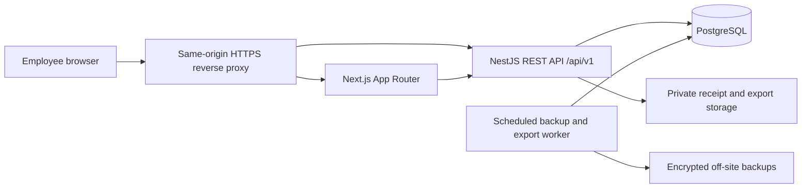

# Architecture

Status: Phase 1 design baseline, not an implemented system. Scope is one shop, one legal business, BDT, online operation. Additional branches, offline POS, and multi-currency accounting need separate designs.

Phase 2 update: the local frontend/API/database/authentication foundation now exists. This document preserves the target architecture; implemented scope and deliberate choices are tracked in [PHASE_2.md](PHASE_2.md). Future-phase behavior described below is not a completion claim.

## System shape

Use a modular monolith: one NestJS business API and one PostgreSQL transactional database, with a separate Next.js web frontend. Modules share transaction infrastructure but own their application services. This keeps stock, invoicing, accounting, and audit changes within a single atomic commit.



The browser calls `/api/v1` on the same origin. Next.js handles presentation, authenticated server rendering, and print views; NestJS alone authorizes and mutates business state. Server rendering forwards the session cookie only to the trusted internal API. Do not place business writes in independent Next.js server actions or duplicate inventory logic in the browser.

## Planned repository structure

```text
apps/
  web/src/app/          # Next.js page groups, no direct database access
  web/src/components/  # shadcn primitives and domain presentation
  web/src/lib/         # typed API client, Zod forms, BDT/date formatting
  api/src/modules/     # domain modules below
  api/src/common/      # guards, filters, validation, request context
packages/
  database/            # Prisma schema, reviewed SQL migrations, client
  api-client/          # generated public DTO types; no Prisma entities
  config/              # shared TypeScript and quality configuration
tests/
  integration/         # real PostgreSQL, concurrent requests, journals
  e2e/                 # browser workflows and print layouts
ops/                   # backup/restore and deployment procedures
docs/                  # architecture, contracts, decisions, test plan
scripts/               # repository tooling
```

These application directories are proposed; Phase 1 creates only planning artifacts. Use npm workspaces initially; avoid a task orchestrator until there is a demonstrated need. Keep database tooling outside the browser dependency graph.

## Domain ownership

| NestJS module | Owns | Calls within a transaction |
| --- | --- | --- |
| Auth / access | Users, sessions, roles, permissions | Audit for access changes |
| Catalog | Product types, brands, categories, products | No stock writes |
| Parties | Suppliers, customers, vehicles, battery sets | No balance writes |
| Purchasing | Draft purchases, purchase items, receiving | Inventory, accounting, audit |
| Inventory | Unit identity, batches, balances, movements, adjustments | Accounting for valuation adjustments |
| Sales | Draft sales, unit allocation, invoices, returns | Inventory, accounting, payments, audit |
| Replacements | Claims, inspections, dispatches, receipts, delivery | Inventory, accounting, audit |
| Accounting | Accounts, journals, payments, allocations, expenses | Audit |
| Reporting | Permission-scoped read models, CSV/PDF jobs | Read-only business projections |
| Settings | Versioned shop, invoice, warranty, payment configuration | Audit |

Controllers validate input and call command services. Command services own transactions; subordinate services accept the same Prisma transaction client. A module may not commit a nested independent transaction. No public generic endpoint may directly edit stock, balances, claim status, posted journal lines, or finalized invoice totals.

## Transaction protocol

For stock and money commands:

1. Authenticate and authorize the current user; validate DTO and resource ownership/scope.
2. Start a database transaction at Serializable isolation for commands spanning balances or multiple documents.
3. Establish the idempotency record using a unique `(actorId, operation, key)` and canonical request hash covering HTTP method, route and target IDs, normalized body, and semantic request headers. A committed same-request replay returns its original response. A different target or payload with that key returns 409.
4. Lock relevant parent documents, units, and quantity layers in stable ID order; re-read all guards inside the transaction. Use conditional updates and check affected row counts. Never trust a prior POS stock lookup.
5. Write document snapshots, movements, valuation allocations, balanced journals, allocations, audit events, and the idempotent response in that transaction.
6. Commit before producing PDFs or notifying downstream systems. Use an outbox record for durable post-commit work if background generation is introduced.
7. Retry serialization failures/deadlocks a bounded number of times with the same key. Exhaustion returns a retriable conflict without partial success.

HTTP retries, double-click protection, optimistic form state, and unique invoice numbers are insufficient by themselves. Business uniqueness constraints also prevent posting the same draft or receipt twice using a new idempotency key. Idempotency records for finalized business writes are retained with their documents; they must not expire in a way that permits reposting.

PostgreSQL documents [row locks](https://www.postgresql.org/docs/current/explicit-locking.html) and [Serializable transaction behavior](https://www.postgresql.org/docs/current/transaction-iso.html). These mechanisms support this design; correctness still requires integration tests of our implementation.

## Authentication and authorization

- Hash passwords with Argon2id using a maintained implementation; benchmark work factors in Phase 2. No default production password.
- Store a cryptographically random opaque session token in a `__Host-hb_session` cookie (`Secure`, `HttpOnly`, `SameSite=Lax`, `Path=/`, no Domain). Store only its digest in PostgreSQL.
- Rotate sessions at login and privilege changes. Enforce idle and absolute expiration, revocation, disabled users, and session invalidation after password reset. Initial timeout values are a configurable security decision.
- Login returns a generic failure, rate-limits attempts, and never logs passwords or cookies. Initial admin is created through a one-time operator command, not public registration.
- Require a session-bound CSRF token and allowed Origin on every unsafe browser request, including login/logout; issue a restricted pre-auth CSRF token for login. Reject missing origins outside explicitly supported non-browser integrations.
- Use deny-by-default permission guards and object-level access checks on API reads, writes, exports, PDFs, and print DTOs. Permission changes take effect on the next request.
- Prevent disabling, demoting, or revoking the last active Owner through ordinary administration. Serialize conflicting access changes and audit every grant/revocation.
- Cost/profit fields come from a separate finance DTO requiring `finance.read`; do not fetch and hide them in CSS. Staff reports and invoice payloads must not contain costs.
- Audit discounts, stock changes, document reversals, role changes, financial corrections, settings changes, and replacement commands with actor, timestamp, reason, request ID, and safe before/after metadata.

The [permission matrix](BUSINESS_RULES.md#permissions) is the initial policy. UI navigation is a convenience, never the security boundary.

## UI and performance

Use a light sidebar/header shell with task-centered tables, responsive forms, keyboard-accessible controls, visible focus, labeled errors, and status text in addition to color. Desktop POS has product selection and cart side by side; small screens use a cart drawer and full-screen unit picker. All transaction confirms show totals and exact selected battery IDs before submission.

Use server pagination, debounced search, query filters, and indexed lookups. List APIs return lean DTOs. Start with direct indexed queries; no Redis requirement. Use private/no-store caching for authenticated financial, stock, and customer responses. POS availability is advisory until command commit. No service-worker write queue or offline sales in the initial scope.

Store invoice and policy snapshots at posting. Generate PDFs from committed snapshots. A failed print or PDF job cannot repeat or roll back a sale. CSV exports neutralize spreadsheet formula prefixes and enforce the same field-level authorization as screen reports.

## Deployment and operations design

Keep hosting undecided in Phase 1. A straightforward deployment is a managed Node.js host for Next.js and NestJS behind one origin, with managed PostgreSQL in a nearby region and private object storage. Vercel is an optional frontend/API host if transaction duration, connection pooling, PDF generation, region, and backup requirements are verified; no provider was provisioned.

Use separate development, test, staging, and production databases and secrets. Validate environment variables at startup; never expose database URLs or session secrets through `NEXT_PUBLIC_*`. Planned variables include `DATABASE_URL`, a migration-role URL, `APP_ORIGIN`, `INTERNAL_API_URL`, session/CSRF secrets, and backup/storage settings. Actual `.env.example` and service configuration belong to Phase 2.

Migration deploys use a dedicated role, never `db push` against production. Run reviewed expand/backfill/contract migrations, take a recoverable backup before risky changes, and rehearse on staging. Recovery uses a forward fix or a tested restore plan, rather than assuming schema rollback is safe.

Plan nightly encrypted off-site logical backups and managed continuous recovery where available. Initial recovery targets: RPO at most 24 hours without PITR; aim for 15 minutes with managed PITR; RTO at most 4 hours after a verified drill. Targets are not guarantees. Alert on missed backups, test restoration into an isolated database, reconcile unit counts/journals/documents, and document retention/access before launch. See Phase 6 tasks in the [implementation plan](IMPLEMENTATION_PLAN.md).

Structured logs carry request IDs and safe error codes, never passwords, tokens, or full customer records. Monitor transaction conflicts, stock reconciliation failures, unbalanced posting attempts, export failures, database capacity, and backup age.

## Dependency selection

Node.js 24 is the proposed common runtime; the workspace has Node 24 available. Official [Node release information](https://nodejs.org/en/about/previous-releases), [Next.js installation requirements](https://nextjs.org/docs/app/getting-started/installation), [NestJS setup](https://docs.nestjs.com/first-steps), and [Prisma's version-specific runtime requirements](https://www.prisma.io/docs/orm/v7/reference/system-requirements) were consulted for this baseline on 2026-11-12.

Phase 2 must select maintained compatible releases of Next.js, React, NestJS, Prisma/client/driver adapter, TypeScript, Tailwind, shadcn/ui, Lucide, Zod, and validation packages. Prisma documentation is versioned: do not infer the current major from a redirected v7 page or use an unreviewed `latest` scaffold. Pin exact versions in manifests and lockfile after clean install, Prisma generation, Next/Nest production builds, and PostgreSQL smoke tests. PostgreSQL 18 is a candidate, subject to selected Prisma/hosting support. No exact version set is represented as installed or tested here.
