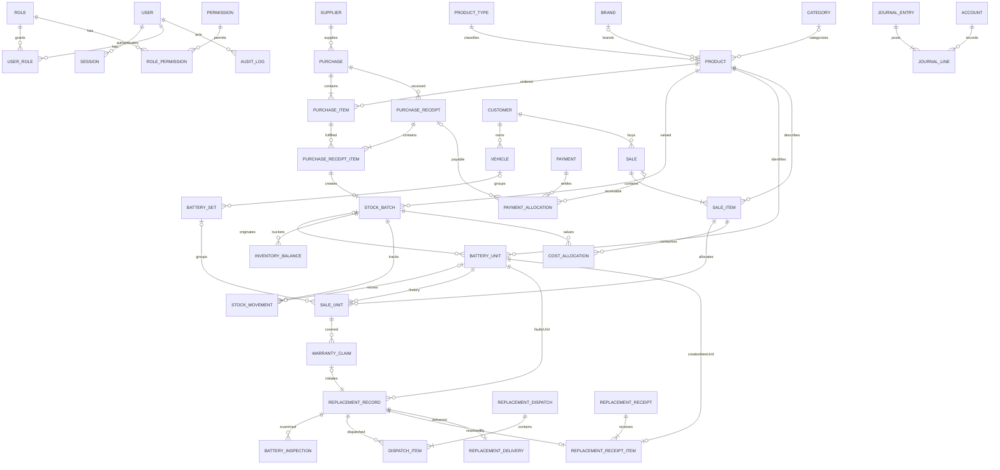

# Database design

Status: logical PostgreSQL design for implementation with Prisma in Phase 2. This is not an executable Prisma schema or migration. Prisma relations, SQL checks, partial indexes, and triggers must be implemented together and verified against real PostgreSQL.

Phase 2 update: the executable [Prisma schema](../packages/database/prisma/schema.prisma) now contains 63 models, with committed foundation and integrity migrations. This document remains the design dictionary; [PHASE_2.md](PHASE_2.md) distinguishes implemented constraints from pending transactional command guards.

## Conventions

- Internal primary keys are UUIDs. Human-facing battery, invoice, receipt, and challan numbers use separate unique immutable codes generated by the server. Sequence gaps are acceptable; reuse is not.
- Store instants as `timestamptz` in UTC. Production date and other business dates use SQL `date`. Date-range reports convert Asia/Dhaka midnight boundaries to UTC using a half-open interval.
- BDT amounts are `numeric(20,2)`; acquisition unit costs and allocation intermediates are `numeric(20,6)`. Parts quantities are `numeric(18,3)` in a product's immutable base unit; battery quantities must be integers. Transport decimals in JSON as strings.
- Required common fields: `id`, `createdAt`, `updatedAt`, and optimistic `version` for editable aggregates. Posted business records have `postedAt` and `postedById`. Use foreign keys with `RESTRICT` for history. Master data is deactivated, not removed when referenced.
- Product, party, shop, warranty, price, and terms snapshots make posted documents independent of later master-data edits. Unique constraints use normalized values where relevant; preserve original display text.

## Entity relationship overview

Diagrams show principal relations; dictionaries below cover additional foreign keys and junctions.

## Access and master data

| Entity | Principal fields and rules |
| --- | --- |
| User | `name`, unique normalized `login`, `passwordHash`, `active`, `passwordChangedAt`; no public signup |
| Session | `userId`, unique `tokenHash`, `csrfTokenHash`, `createdAt`, `lastSeenAt`, `expiresAt`, `revokedAt`; token never stored in plaintext |
| Role / Permission | Unique stable `code`, display name; built-in roles protected against accidental removal |
| UserRole / RolePermission | Composite unique foreign-key pairs; role edits audited |
| ProductType | Unique code; immutable `trackingKind=BATTERY_UNIT or QUANTITY`; permanent categories are Battery, Parts & Accessories, and Easy Bike & Rickshaw; API creation/deletion is disabled |
| Brand | Unique normalized name; active flag |
| Category | Unique normalized name, optional parent category, active flag; no cycles |
| Product | Unique SKU; `typeId`, `brandId?`, `categoryId?`, `name`, `model`, normalized identity key, description, base unit, default sale price, optional default purchase price, low-stock threshold, active flag |
| BatteryProductDetail | One-to-one `productId`, capacity Ah, voltage, `identificationMethod=SERIAL/PRODUCTION_DATE/BOTH`, `defaultWarrantyMonths`; brand required on battery products |
| PartsProductDetail | One-to-one `productId`, specifications, optional warranty months; category required on parts |
| Supplier | `name`, company, optional brand relation, normalized phone, address, active flag; phone indexed rather than assumed globally unique |
| Customer | `name`, normalized phone, address, active flag; phone indexed, duplicate warning and authorized merge workflow rather than blanket uniqueness |
| Vehicle | Empty legacy compatibility table; vehicle tracking was removed. A database constraint rejects new rows. |
| BatterySet | `customerId`, label, created date; the legacy `vehicleId` is cleared and no longer populated |

Prisma cannot enforce all subtype rules by declarations alone. Add SQL constraints/triggers or transaction-checked invariants so exactly the matching detail row exists for each product. Product duplicate identity is a stored canonical key built from type, brand/category, model, battery capacity/voltage or parts specification variant, and unit. Equivalent normalized identities conflict; legitimate specification variants remain possible. Never derive identity from selling price. Tracking kind, unit, and identity method cannot change after units or transactions reference the product; create a successor product instead.

## Purchasing and inventory

| Entity | Principal fields and rules |
| --- | --- |
| Purchase | Unique purchase number, supplier ID, supplier invoice reference, `status=DRAFT/PARTIALLY_RECEIVED/RECEIVED/CANCELLED`, order date, discount and landed-cost plan, optional `remainderCancelledAt`, version |
| PurchaseItem | Purchase/product IDs, line number, ordered quantity, unit price, allocated discount/cost, expected unit cost; unique `(purchaseId,lineNumber)` |
| PurchaseRemainderCancellation | Purchase/item IDs, cancelled quantity, reason, actor, timestamp; ordered minus received minus cancelled is remaining receivable quantity |
| PurchaseReceipt | Unique receipt number, purchase ID, receiving date, posting reference; immutable after posting |
| PurchaseReceiptItem | Receipt/purchase-item IDs, quantity, net cost; unique `(receiptId,purchaseItemId)`; aggregate receipts cannot exceed ordered quantity |
| StockBatch | Product ID, origin `PURCHASE/REPLACEMENT/RETURN/OPENING/ADJUSTMENT`, optional unique receipt-item ID or replacement-receipt-item ID, original quantity, unit cost, acquired date; origin-specific exactly-one source constraint |
| BatteryUnit | Unique immutable internal code, product ID, batch ID, optional serial display and normalized serial, optional production date, condition/custody/ownership/commercial state, provenance, version, optional reserved customer/claim IDs |
| InventoryBalance | Parts only: batch ID, location, disposition bucket, quantity; unique `(batchId,location,bucket)`; nonnegative check |
| StockMovement | Unique `(postingId,lineNumber)`, product/batch ID, optional battery-unit ID, quantity, from/to custody and disposition, reason, actor, timestamp, source document FKs, reversal reference |
| StockAdjustment | Unique adjustment number, authorized reason, approval/actor, lines, journal link; posted corrections append reversal movements |
| StockAdjustmentItem | Adjustment ID, product/batch/unit IDs as applicable, quantity, from/to disposition, valuation impact and movement reference |
| OpeningBalance | Approved cutover document with quantities/units, actual costs, party balances, reconciliation reference; exceptional opening stock source, never product creation |
| OpeningBalanceItem | Opening document ID, typed stock or party balance details, unit identity where tracked, acquisition cost/account mapping, deduplication key |

Battery stock is derived from BatteryUnit and its movements; do not also treat it as a quantity balance that can drift. Parts balances are an atomically updated projection backed by movements. Battery movement quantity is exactly one. Parts layer allocations allow fractional base-unit quantities. All internal transfers use a positive quantity and from/to dimensions; additions/removals use an explicit external endpoint, not negative stock balances.

Unit serial uniqueness is initially **per product** via partial unique `(productId, normalizedSerial)` where serial is present. This includes sold and retired history. Supplier policy may require a stricter brand scope before implementation; do not relax uniqueness silently. Production dates have no unique constraint. SERIAL requires serial, PRODUCTION_DATE requires date, BOTH requires both. Blank serial becomes null. Known repeated factory serials require an explicit policy decision; they cannot silently bypass the rule.

Each newly received replacement gets a new batch and new BatteryUnit. `ReplacementReceiptItem.oldUnitId` and `newUnitId` link history; `newUnitId` is unique. The old unit's serial, original batch, and acquisition history never change. Before-sale replacement transfers the remaining carrying cost to its successor without recording a new purchase. Customer replacements have zero shop inventory carrying cost unless the shop separately acquires economic ownership; inherited historical warranty cost remains in the original sale/lineage, not in a new COGS posting.

## Sales, returns, warranty

| Entity | Principal fields and rules |
| --- | --- |
| Sale | Unique invoice number assigned on confirmation, customer ID, status `DRAFT/CONFIRMED/PARTIALLY_RETURNED/RETURNED/CANCELLED`, sold timestamp, monetary totals, invoice/shop/customer snapshot, version |
| SaleItem | Sale/product IDs, line number, product snapshot, quantity, unit selling price, allocated discount, net revenue, cost total, warranty policy snapshot; unique `(saleId,lineNumber)` |
| SaleUnit | Sale-item ID, unit ID, optional battery-set ID, coverage start/expiry dates, cost at sale, `releasedAt?`; one active sale-unit assignment per battery using partial unique unit ID where not released |
| CostAllocation | Sale-item ID, batch ID, optional unit ID, quantity, exact unit cost, rounded COGS; immutable, reversed by linked return allocation |
| SalesReturn / SalesReturnItem | Original sale/item/unit links, quantity, refund/credit amounts, disposition, inspection, reason, posting ID; prevents returning more than unreturned quantity |
| SupplierReturn / SupplierReturnItem | Original purchase receipt/item/unit links, return quantity, carrying cost, supplier credit/settlement, reason and posting ID; requires actual returnable shop-owned stock, preserves downstream allocations, never deletes the original receipt |
| WarrantyClaim | Unique claim receipt number, customer ID, sale-unit ID, currently faulty unit ID, complaint, eligibility decision, policy snapshot, received date, original or authorized overridden expiry, claim receipt snapshot |
| BatteryInspection | Replacement ID, unit ID, inspector, timestamp, test readings, complaint/result, decision, notes; append-only |
| ReplacementRecord | Unique claim code, source `BEFORE_SALE/CUSTOMER_WARRANTY`, old-unit ID, warranty-claim ID nullable, supplier ID, status, outcome, fault reason, reserved customer ID, version |
| ReplacementDispatch | Unique challan, supplier ID, dispatch timestamp/reference, actor, document snapshot |
| DispatchItem | Dispatch/replacement IDs, old-unit ID, optional returned date; one active dispatch per replacement; dispatch supplier must match claim |
| ReplacementReceipt | Unique receipt number, supplier ID, received timestamp, reference, posting ID |
| ReplacementReceiptItem | Receipt ID, unique replacement ID, dispatch-item ID, old-unit ID, unique new-unit ID, inspected result, inherited valuation, policy snapshot |
| ReplacementDelivery | Unique receipt number, unique replacement ID, customer ID, new-unit ID, delivered timestamp, recipient, snapshot |
| ReplacementOutcomeEvent | Replacement ID, rejection reason, faulty-unit return/disposal event, settlement/reference, actor; keeps rejection resolution separate from success |

One open replacement per old unit via a partial unique index over nonterminal status. A REJECTED claim remains open for this purpose until faulty-unit return/disposal is resolved. `outcomeResolvedAt` distinguishes that from a successful Completed claim. Subsequent failures of a replacement unit create new claims linked to the same original SaleUnit, with the previous receipt as provenance; verify the currently held descendant is the submitted faulty unit and that no active claim covers it.

Supplier dispatches and receipts are headers with items, so one challan can hold many claims and receipts can fulfill subsets. Each claim resolves one physical battery; swapping a set of five uses five claims optionally sharing a group reference. A receipt can cover items from multiple dispatches to the same supplier. Rejection returns the old unit through an outcome event, not by creating a successful replacement receipt or overwriting identity.

## Finance, audit, settings

| Entity | Principal fields and rules |
| --- | --- |
| Account | Unique chart code, name, kind `ASSET/LIABILITY/EQUITY/REVENUE/EXPENSE`, optional payment-method mapping |
| JournalEntry | Unique posting ID, posting date, exactly one typed source reference, optional unique reversed-entry ID, reason, actor; immutable once posted |
| JournalLine | Entry/account IDs, optional customer/supplier ID, debit, credit; nonnegative, exactly one positive side, total debits equal credits at commit |
| Payment | Unique payment number, direction, customer OR supplier ID, amount, payment method, cash/bank account ID, reference, occurred timestamp, unique journal entry, reversal reference |
| PaymentAllocation | Payment ID, sale ID OR purchase-receipt ID, allocated amount, optional unique reversed-allocation ID; exactly one target, party/direction/currency must match; aggregate net allocation cannot exceed payment or remaining due |
| Expense | Category ID, description, amount, occurred date, payment/accounting treatment, posting ID; cost recorded once, settlement linked to avoid double-counting |
| ExpenseSettlement | Expense ID, amount, asset account, settlement timestamp, journal ID and reversal link; records cash/bank outflow without repeating expense recognition |
| ExpenseCategory | Unique name, mapped expense account, active flag |
| ReplacementCharge | Replacement ID, type `FEE/TRANSPORT/ADJUSTMENT`, expense or receivable/payable treatment, payer, amount, optional journal link; treatment explicitly reviewed |
| IdempotencyRecord | Actor ID, operation, key, canonical method/route/target/body hash, response status/body, source ID, created date; unique `(actorId,operation,key)` |
| AuditLog | Actor ID, action, resource type/ID, safe metadata, reason, request ID, timestamp; append-only restricted access |
| ApplicationSetting | Unique key, version, typed value, changed by/at; secrets excluded |
| WarrantyPolicy | Versioned company/product policy, period, eligibility basis, replacement expiry behavior, exclusions; immutable versions referenced by transactions |
| DocumentSnapshot | Source type/ID, document kind/version, safe JSON snapshot, optional private artifact key/checksum; render from snapshot |
| OutboxEvent | Optional when asynchronous work is implemented: unique event ID, type, payload, status, attempts, next attempt; written with transaction |

JournalLines, rather than editable customer/supplier due columns, are the accounting source of truth. Payment allocations support document-level aging; reconcile their totals to control-account balances. Purchase receipts recognize inventory and supplier payable; supplier advances stay separate until allocated. Finalize landed costs before first receiving in the initial implementation. Later price/freight corrections need an authorized valuation journal that splits remaining stock and already recognized COGS, not rewriting historical costs.

## Constraints and indexes to implement

1. Unique natural codes, normalized SKU/product identity, normalized serial scope, source receipt IDs, invoice numbers, idempotency scope, and `(postingId,lineNumber)`.
2. Checks for nonnegative money/quantity, strictly positive movement/payment/return quantities, battery integer quantities, valid source XORs, expiry not before coverage start, and nonnegative balances.
3. Deferred SQL constraint triggers for balanced journals and aggregate invariants not expressible as row checks. Privileged roles cannot use ordinary API access to bypass service posting rules.
4. Partial unique indexes for active sale allocation, unresolved replacement, active dispatch, and optional vehicle IDs. Provide explicit SQL migrations when Prisma cannot express a constraint.
5. Battery selection index `(productId,commercialState,custody,condition,ownership)`; serial/internal-code search indexes; production-date index is non-unique.
6. Ledger indexes `(productId,occurredAt,id)`, `(batteryUnitId,occurredAt,id)`, `(batchId,occurredAt,id)` and typed source references.
7. Party phone indexes; sale `(customerId,soldAt,id)`, receipt `(purchaseId,postedAt,id)`, claim `(status,supplierId,createdAt,id)`, session token/expiry indexes, journal account/date and party/date indexes.
8. No cascade deletion of finalized business records. Changes to a product/party name do not mutate snapshots. Sensitive audit tables disallow application update/delete grants.

## Transaction boundaries and reconciliation

Receiving locks purchase lines and verifies cumulative receipt quantity before creating batches/units, movements, payable journals, and status updates. Confirmation locks draft and selected units/layers; conditional eligibility updates must affect every requested unit/quantity. Payments lock the party and target documents before applying allocations. Replacements lock claim, old/new unit, dispatch/receipt, and reservation together.

Use a consistent lock order: idempotency key, aggregate header, party/accounting control as needed, product/batch IDs, unit IDs, then append records. Commands touching more than one aggregate sort IDs within each class. Retry deadlocks/serialization failures; do not retain external network calls while holding database locks.

Reconcile unit states against unit movement histories, parts balances against bucket movement sums, stock valuation against inventory control accounts, sale allocations against COGS, and party allocations against receivables/payables. Reports must not sum every historical unit as current stock: replaced predecessors remain historical but have no active carrying value or sellable quantity.

Schema acceptance in Phase 2 requires creating the database from migrations and proving the SQL constraints. Phase 3 onward adds full workflow integration tests; the design alone does not establish correctness.
