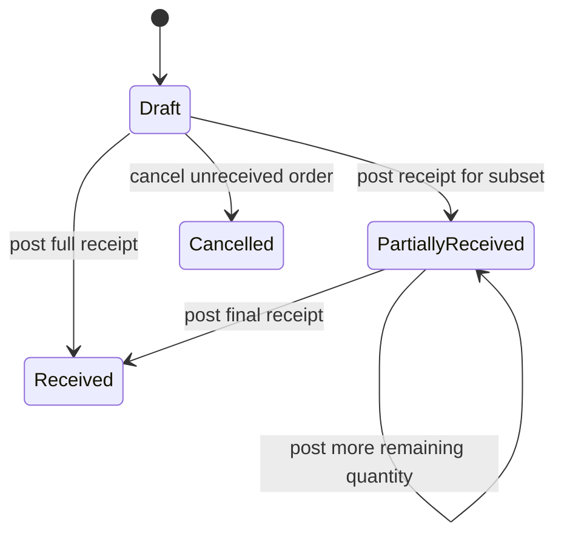
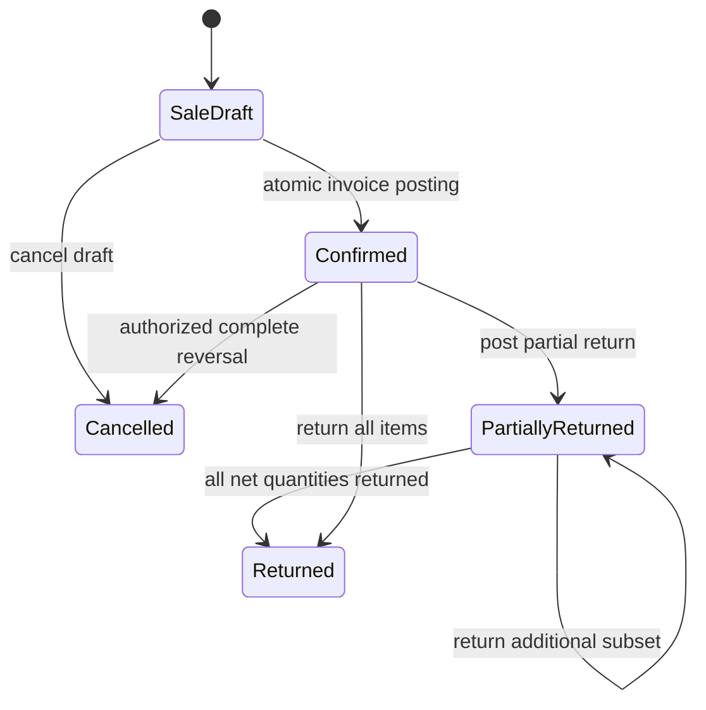
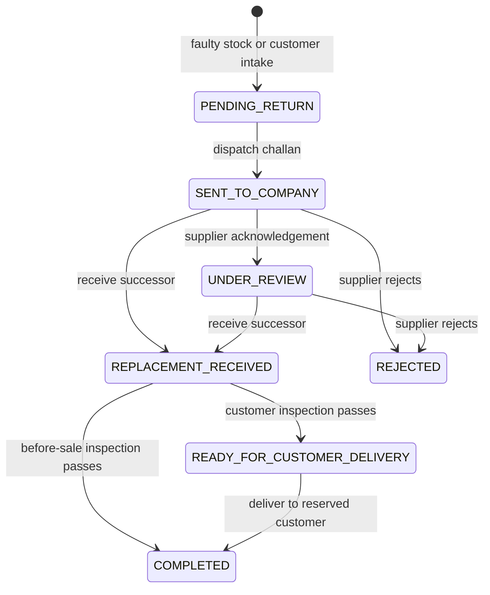

# Inventory and replacement state machines

Status: design specification. Allowed replacement edges are also in the [JSON workflow contract](contracts/replacement-workflow.json). The contract describes guards; no runtime engine exists yet.

## Independent battery dimensions

| Dimension | Values | Meaning |
| --- | --- | --- |
| Condition | PENDING_INSPECTION, GOOD, FAULTY, SCRAP | Physical assessment |
| Custody | SHOP, CUSTOMER, SUPPLIER, DISPOSED | Physical holder/location |
| Ownership | SHOP, CUSTOMER, DISPOSED | Economic ownership, independent of physical holder |
| Commercial state | AVAILABLE, RESERVED, UNAVAILABLE, SOLD, RETIRED | Eligibility and lifecycle |
| Provenance | PURCHASE, REPLACEMENT, RETURN, OPENING, ADJUSTMENT | How the unit entered the record |
| Replacement source | BEFORE_SALE, CUSTOMER_WARRANTY | Why a particular replacement case exists |

These are separate columns, not one overloaded status enum. Normal sale eligibility is the conjunction in STK-04. Customer-owned replacements remain outside shop inventory valuation even while physically on site.

Normal purchase receiving accepts inspected goods as GOOD/SHOP custody/SHOP ownership/AVAILABLE. Sale confirmation changes the exact selected units to GOOD/CUSTOMER custody/CUSTOMER ownership/SOLD. An accepted resale return changes ownership/custody back to SHOP but stays UNAVAILABLE until inspection confirms GOOD; faulty returns remain unavailable. These transitions also append movements and their appropriate valuation journals.

The UI displays compound states derived from these dimensions:

| UI label | Required meaning |
| --- | --- |
| Available | GOOD + SHOP custody + SHOP ownership + AVAILABLE |
| Reserved | Reserved for a named customer/claim, unavailable for POS |
| Replaceable | FAULTY + unavailable, pending supplier dispatch |
| In Replacement | Active case with supplier custody or pending inspection |
| Sold | Customer-held sold unit; no shop available balance |
| Replaced | RETIRED predecessor with a linked successor |
| Rejected / Scrap | Rejected claim is shown separately from SCRAP physical condition |

## Purchase and sale aggregates

A partial order may have its outstanding quantity cancelled without erasing the received portion: retain `PARTIALLY_RECEIVED` plus an explicit `remainderCancelledAt` and cancelled-quantity record. Quantity checks use ordered minus received minus cancelled. The database design's purchase status is supplemented by these cancellation fields when implemented. Fully received receipts are never deleted; supplier returns are separate documents.

Payment status UNPAID/PARTIAL/PAID is derived independently. Reversing a payment never changes physical stock. A cancellation is allowed only when dependent records can be safely settled/reversed; see COR-02.

## Replacement workflow

| Command | Preconditions | Atomic effects |
| --- | --- | --- |
| Before-sale intake | Available shop-owned unit, no open case, fault reason, supplier | Create case/inspection, mark FAULTY/UNAVAILABLE, keep SHOP custody, append movement/audit |
| Customer intake | Original sale/descendant verified, eligible warranty or authorized exception, customer physically returns unit | Create claim/receipt/case; CUSTOMER ownership, SHOP custody, FAULTY/UNAVAILABLE; movement/audit; no shop asset increase |
| Dispatch | PENDING_RETURN, SHOP custody, matching supplier, unique active dispatch item | Challan and items; old custody SUPPLIER, unavailable; SENT_TO_COMPANY |
| Under review | SENT_TO_COMPANY, supplier reference | UNDER_REVIEW with event/audit; no inventory change |
| Receive replacement | SENT_TO_COMPANY or UNDER_REVIEW, unmatched active dispatch, new identity, no existing successor | Receipt/item, new unit/batch, old RETIRED, successor SHOP custody/PENDING_INSPECTION/UNAVAILABLE, lineage and value transfer, REPLACEMENT_RECEIVED |
| Release after inspection | REPLACEMENT_RECEIVED, successor passed GOOD inspection | BEFORE_SALE: SHOP-owned AVAILABLE and COMPLETED. CUSTOMER_WARRANTY: CUSTOMER-owned RESERVED for correct customer/claim and READY_FOR_CUSTOMER_DELIVERY |
| Customer delivery | READY_FOR_CUSTOMER_DELIVERY, matching customer/claim/unit, recipient | Successor custody CUSTOMER/commercial SOLD; delivery receipt, movement, COMPLETED; preserve warranty expiry |
| Reject | SENT_TO_COMPANY or UNDER_REVIEW, supplier decision reason | REJECTED, old still unavailable/supplier-held until resolution; no fictional new unit |
| Resolve rejection | REJECTED, unresolved outcome, physical return or authorized disposal documented | Update custody/condition with movement, post approved loss/credit/fee if needed, set outcomeResolvedAt; status remains REJECTED |

Receipt and inspection release are distinct commands. A new replacement never becomes sellable merely because a supplier sent it. An accepted replacement may be received and released in one user flow, but both commands preserve their own posting identity and audit. Batch receipt leaves unlisted dispatch items outstanding.

Failed successor inspection records FAULTY/UNAVAILABLE and leaves the case at REPLACEMENT_RECEIVED. It does not release, complete, or make a second successor. Phase 5 must implement an explicit linked supplier rework/return flow for that successor before this exception is usable in production; see the unresolved decisions. A generic status patch must never bypass it.

## Rejected outcomes

REJECTED records the adjudication, not physical completion. Resolution modes are:

- BEFORE_SALE / return to shop: SHOP ownership/custody, UNAVAILABLE. Release requires a separate GOOD inspection and authorized stock adjustment; SCRAP disposal posts the appropriate value write-off.
- CUSTOMER_WARRANTY / return to customer: customer-owned faulty unit returns to CUSTOMER custody, SOLD/FAULTY, with a return acknowledgement. Returning via the shop records both custody legs.
- Authorized disposal: DISPOSED custody/ownership and SCRAP/RETIRED state with approval and financial treatment appropriate to ownership.

Resolving rejection never sets COMPLETED, which is reserved for successful replacement. Customer-owned goods cannot be disposed without the required recorded consent. Repeat resolution conflicts; replay of the original key returns the original result.

## Invariants at every commit

1. Every battery ID identifies exactly one physical historical unit; successor IDs differ from predecessor IDs.
2. No unit is both normally available and reserved/under unresolved replacement.
3. At most one active sale allocation and one unresolved replacement apply to a physical unit.
4. Every state change has a source movement/audit event in the same transaction.
5. Customer-reserved units always carry customer and claim references, and cannot become normal sale stock.
6. Stock movements, balances, valuation, and journal totals agree after posting and reversal.
7. A wrong-state command returns 409 without changing state; commands cannot skip supplier dispatch or inspection.
